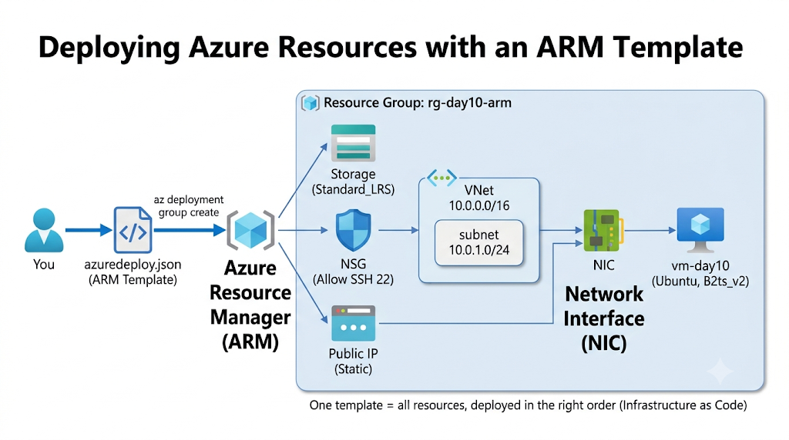

# ARM Template Demo — Deployment Commands

This folder deploys a **Storage Account + Virtual Network + NSG + Public IP + NIC + Virtual Machine** using one ARM JSON template.



Files:
- `azuredeploy.json` — the ARM template (all resources, fully commented)
- `azuredeploy.parameters.json` — the values (username, password, VM size)

Run the commands below in **Azure Cloud Shell** or local **Azure CLI**.

---

## Step 1: Log in (skip in Cloud Shell)
```bash
az login
```

## Step 2: Create a resource group
```bash
az group create --name rg-day10-arm --location eastus
```

## Step 3: Edit the password first!
Open `azuredeploy.parameters.json` and change `adminPassword` to a strong value
(min 12 chars, upper + lower + number + symbol).

## Step 3b: Pick an available VM size (avoids SkuNotAvailable error)
Old sizes (`Standard_B1s`, `Standard_B2s`, and most v1-v4 series) are now retired/restricted,
especially on free/trial subscriptions. This template defaults to **`Standard_B2ts_v2`**.

List the sizes your subscription can actually deploy (no restrictions):
```bash
az vm list-skus --location centralindia --resource-type virtualMachines --all --query "[?restrictions[0]==null].name" -o tsv | sort -u | head -60
```
Pick one and set it as `vmSize` in `azuredeploy.parameters.json`. Modern good choices:
`Standard_B2ts_v2`, `Standard_B2s_v2`, `Standard_D2s_v5`.

If nothing is available in your region, switch regions (see troubleshooting at the bottom).

## Step 4: Validate the template (check for errors before deploying)
```bash
az deployment group validate --resource-group rg-day10-arm --template-file azuredeploy.json --parameters azuredeploy.parameters.json
```

## Step 5: Preview what will be created (what-if)
```bash
az deployment group what-if --resource-group rg-day10-arm --template-file azuredeploy.json --parameters azuredeploy.parameters.json
```

## Step 6: Deploy
```bash
az deployment group create --resource-group rg-day10-arm --template-file azuredeploy.json --parameters azuredeploy.parameters.json
```

## Step 7: Check what got created
```bash
az resource list --resource-group rg-day10-arm --output table
```

## Step 8: Get the VM public IP
```bash
az network public-ip show --resource-group rg-day10-arm --name pip-day10 --query ipAddress -o tsv
```

## Step 9: Connect to the VM
```bash
ssh azureuser@<PUBLIC-IP>
```

## Step 10: Clean up (delete everything)
```bash
az group delete --name rg-day10-arm --yes --no-wait
```

---

## Troubleshooting: SkuNotAvailable / Capacity Restrictions

**Why this happens:** Older VM series (v1-v4), including `Standard_B1s`, `Standard_B1ms`,
and `Standard_B2s`, are being retired/restricted — especially on free and trial
subscriptions. Microsoft now recommends the newer **Bsv2 / v5+** sizes.
This template defaults to **`Standard_B2ts_v2`** (the current free-tier friendly size).

**Step 1 — list the sizes YOUR subscription can actually deploy (no restrictions):**
```bash
az vm list-skus --location centralindia --resource-type virtualMachines --all \
  --query "[?restrictions[0]==null].name" -o tsv | sort -u | head -60
```
(Change `--location` to your region.) Pick any name from this list.

**Step 2 — set that size in `azuredeploy.parameters.json` → `vmSize`.**
Good modern choices (try in this order):
- `Standard_B2ts_v2`  (free-tier friendly, cheapest)
- `Standard_B2s_v2`
- `Standard_D2s_v5`
- `Standard_D2as_v5`

**Step 3 — re-validate and deploy:**
```bash
az deployment group validate --resource-group rg-day10-arm --template-file azuredeploy.json --parameters azuredeploy.parameters.json
az deployment group create --resource-group rg-day10-arm --template-file azuredeploy.json --parameters azuredeploy.parameters.json
```

**If nothing works in your region, switch regions:**
```bash
az group delete --name rg-day10-arm --yes
az group create --name rg-day10-arm --location westus2
```
Then validate/deploy again (the template uses the resource group's region automatically).
Regions to try: `centralindia`, `westus2`, `westeurope`, `southeastasia`, `eastus2`.

> Note: Free Trial subscriptions can't request quota increases, so stick to the
> non-restricted sizes shown by the Step 1 command.

---

### Notes
- If `Standard_B2s` is not available in your region, change `vmSize` in the parameters file (try `Standard_B1s` or `Standard_B1ms`), or deploy to another region.
- `uniqueString()` makes the storage account name globally unique automatically.
- Never commit real passwords — this demo password is a placeholder, change it.
