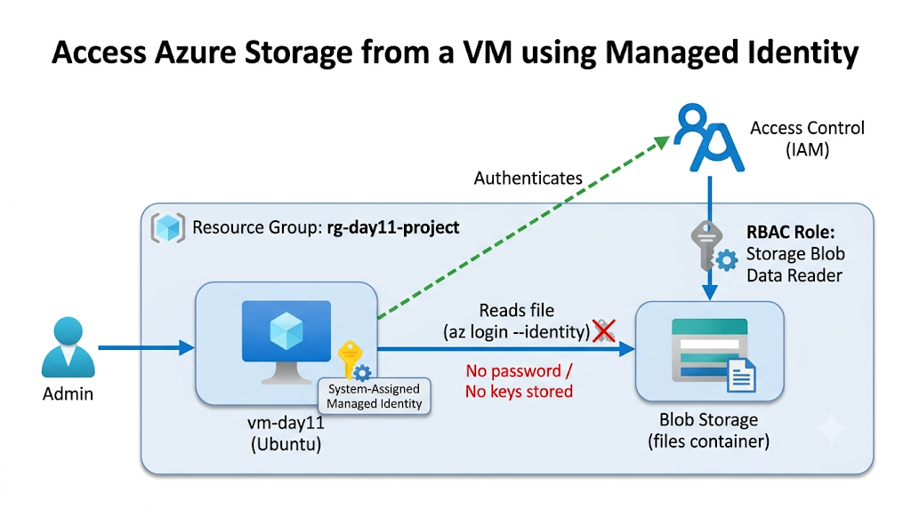

# Project: Access Storage Files from a VM (Portal UI — Click by Click)

Click-by-click steps in the Azure Portal. ✅

**Goal:** Create a storage account (Azure's version of an AWS S3 bucket), upload a file,
create a VM, and let the VM read that file — using a **Managed Identity + RBAC role**,
with **no passwords or keys stored** on the VM.



```text
Storage Account (blob container)  ← file
        ▲
        │  RBAC role: "Storage Blob Data Reader"
        │
Virtual Machine (Managed Identity)  → reads the file securely
```

---

## PART 1 — Create a Resource Group
1. Go to https://portal.azure.com and sign in.
2. In the top search bar, type `Resource groups` → click it.
3. Click **+ Create**.
4. **Resource group**: `rg-day11-project`
5. **Region**: `Central India` (or one close to you).
6. Click **Review + create** → **Create**.

---

## PART 2 — Create a Storage Account (the "S3 bucket")
1. Top search bar → type `Storage accounts` → click it.
2. Click **+ Create**.
3. **Resource group**: `rg-day11-project`
4. **Storage account name**: `stday11proj123` (lowercase, unique — add numbers if taken).
5. **Region**: same as the group.
6. **Primary service**: Azure Blob Storage.
7. **Performance**: Standard, **Redundancy**: LRS.
8. Click **Review + create** → **Create**.
9. When done, click **Go to resource**.

---

## PART 3 — Create a Blob Container and Upload a File
1. In the storage account, left menu → **Data storage** → **Containers**.
2. Click **+ Container**.
3. **Name**: `files`, **Anonymous access level**: Private → **Create**.
4. Click the `files` container to open it.
5. Click **Upload**.
6. Click **Browse for files**, pick any file (e.g. a `.txt` or image) → **Upload**.
7. You now see your file listed inside the container. ✅

---

## PART 4 — Create a Virtual Machine (with Managed Identity)
1. Top search bar → type `Virtual machines` → click it.
2. Click **+ Create** → **Azure virtual machine**.
3. **Basics** tab:
   - **Resource group**: `rg-day11-project`
   - **Virtual machine name**: `vm-day11`
   - **Region**: same as before
   - **Image**: `Ubuntu Server 22.04 LTS`
   - **Size**: `Standard_B2ts_v2` (change if not available)
   - **Authentication type**: SSH public key
   - **Username**: `azureuser`
   - **Key pair name**: `vm-day11-key`
   - **Inbound ports**: allow `SSH (22)`
4. Go to the **Management** tab.
5. Find **Identity** → turn **ON** the toggle for **System assigned managed identity**. ✅
   (This gives the VM its own Azure identity — no stored passwords.)
6. Click **Review + create** → **Create**.
7. On the popup, click **Download private key and create resource** (save the `.pem`).
8. When done → **Go to resource** → copy the **Public IP address**.

> Already created the VM without identity? Open the VM → left menu → **Security** → **Identity** → **System assigned** tab → **Status: On** → **Save**.

---

## PART 5 — Give the VM Access to the Storage (RBAC Role)
1. Go back to your **storage account** (`stday11proj123`).
2. Left menu → **Access Control (IAM)**.
3. Click **+ Add** → **Add role assignment**.
4. **Role** tab: search and select **Storage Blob Data Reader** → **Next**.
5. **Members** tab:
   - **Assign access to**: choose **Managed identity**.
   - Click **+ Select members**.
   - **Managed identity** dropdown: choose **Virtual machine**.
   - Select **vm-day11** → **Select**.
6. Click **Review + assign** → **Review + assign** again.
7. The VM's identity now has read access to the storage blobs. ✅

---

## PART 6 — Connect to the VM
1. Open **vm-day11** → click **Connect** → **SSH** (or **Bastion**).
2. From your terminal:
   ```bash
   ssh -i vm-day11-key.pem azureuser@<PUBLIC-IP>
   ```
3. Type `yes` to continue. You are now inside the VM.

---

## PART 7 — Read the File from the VM (no password!)
Run these **inside the VM**:
1. Install Azure CLI:
   ```bash
   curl -sL https://aka.ms/InstallAzureCli | sudo bash
   ```
2. Log in using the VM's managed identity (no password):
   ```bash
   az login --identity
   ```
3. Download the file you uploaded earlier:
   ```bash
   az storage blob download --account-name stday11proj123 --container-name files --name <your-file-name> --file downloaded-file --auth-mode login
   ```
4. Check it worked:
   ```bash
   ls -l downloaded-file
   ```
   The file downloaded with **zero stored credentials** — only the VM's identity + the RBAC role. ✅

---

## PART 8 — Clean Up (avoid charges 💰)
1. Top search bar → `Resource groups` → click `rg-day11-project`.
2. Click **Delete resource group**.
3. Type `rg-day11-project` to confirm → **Delete**.

---

## ✅ What This Project Teaches
- Storage account = Azure's object storage (like **AWS S3**).
- **Managed Identity** = an Azure identity for the VM — no passwords/keys to manage.
- **RBAC role** (`Storage Blob Data Reader`) = exactly what the VM is allowed to do.
- This is the secure, real-world way apps on a VM access Azure storage.
