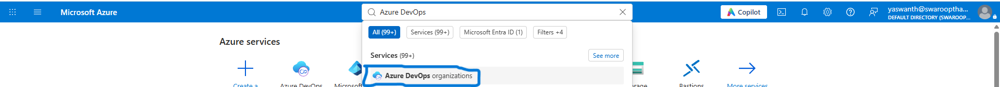
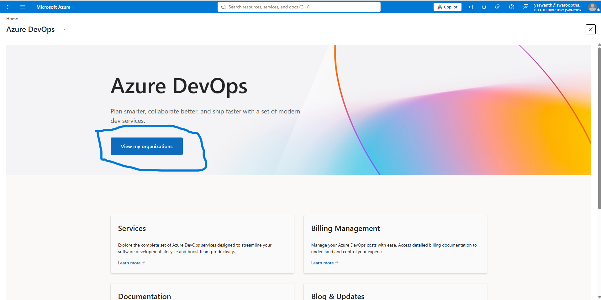
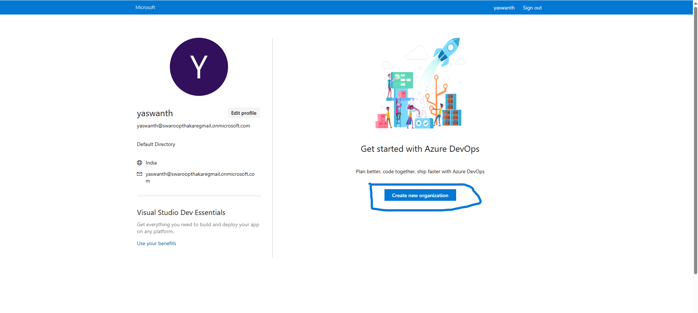
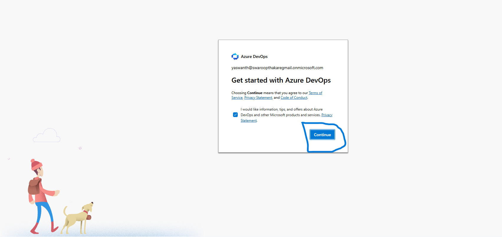
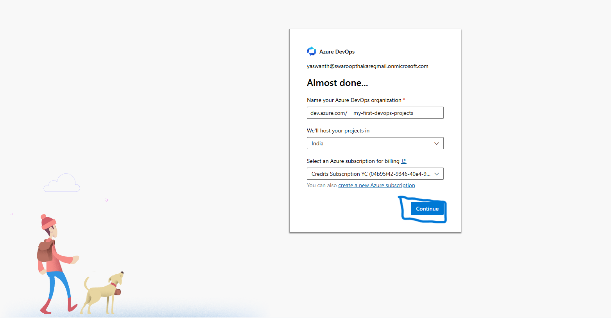
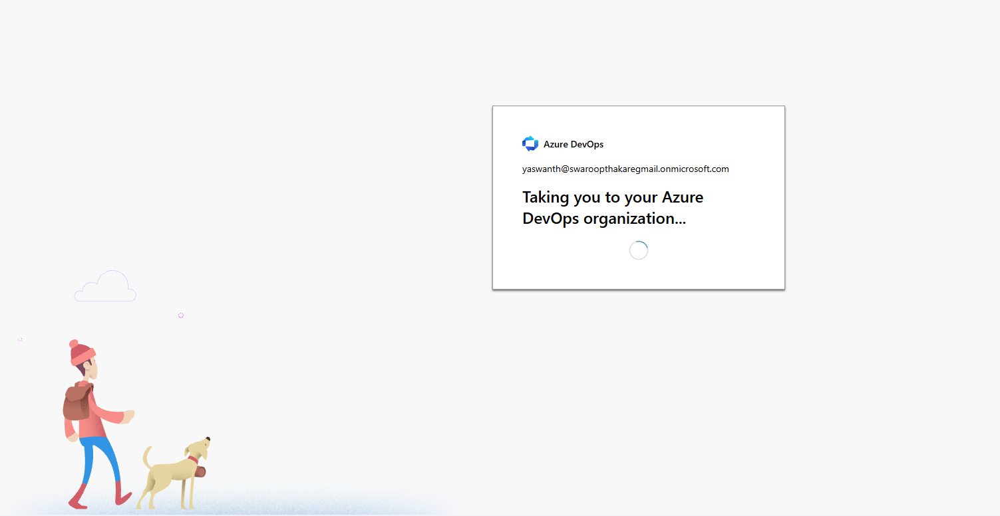
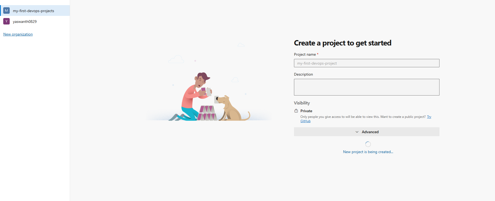
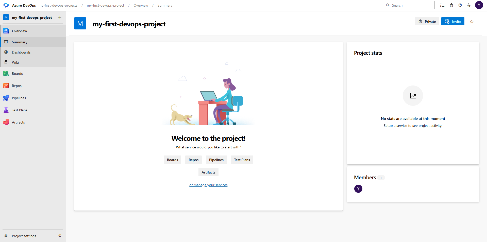

# Day 12: Introduction to Azure DevOps

Short and simple. What Azure DevOps is, and how to set up your first project and repo.

---

## What is Azure DevOps?

A set of tools to plan, build, test, and deploy software — all in one place.

```text
Plan  →  Code  →  Build  →  Test  →  Release  →  Deploy
```

---

## The 5 Azure DevOps Services

| Service | What it's for |
|---------|---------------|
| **Azure Boards** | Plan work — tasks, bugs, sprints (like Jira) |
| **Azure Repos** | Git repositories to store your code |
| **Azure Pipelines** | CI/CD — build, test, and deploy automatically |
| **Azure Test Plans** | Manual and automated testing |
| **Azure Artifacts** | Store packages (npm, NuGet, Maven, etc.) |

---

## Step 1: Create an Azure DevOps Organization
1. Go to https://dev.azure.com and sign in with your Microsoft account.
2. Click **New organization**.
3. Give it a name and pick a region → **Continue**.








## Step 2: Create a Project
1. Inside your organization, click **+ New project**.
2. **Project name**: `my-first-devops-project`.
3. **Visibility**: Private.
4. Click **Create**.

## Step 3: Explore the Services (left menu)
- **Boards** → plan tasks
- **Repos** → your code
- **Pipelines** → CI/CD
- **Test Plans** → testing
- **Artifacts** → packages




## Step 4: Set Up a Repository (Azure Repos)
1. Left menu → **Repos**.
2. A default Git repo is already created with your project name.
3. To start fresh, scroll down and click **Initialize** (adds a README).





## Step 5: Clone the Repo to Your Computer
1. In **Repos**, click **Clone** (top right).
2. Copy the HTTPS URL.
3. On your computer:
   ```bash
   git clone <REPO-URL>
   cd <repo-folder>
   ```

## Step 6: Push Code
```bash
echo "# My first Azure DevOps repo" > README.md
git add .
git commit -m "first commit"
git push origin main
```
Refresh **Repos** in the browser — your file appears. ✅


## Step 7: Create a Work Item (Azure Boards)
1. Left menu → **Boards** → **Work items**.
2. Click **+ New Work Item** → **Task**.
3. Give it a title (e.g. "Set up CI pipeline") → **Save**.


---

## ✅ Remember
- Azure DevOps = Plan + Code + Build + Test + Deploy in one platform.
- **Repos** = your Git code, **Boards** = planning, **Pipelines** = CI/CD.
- Start by creating an **organization** → **project** → **repo**.
- We'll build CI/CD pipelines in the next days (Project 3 & 4).
